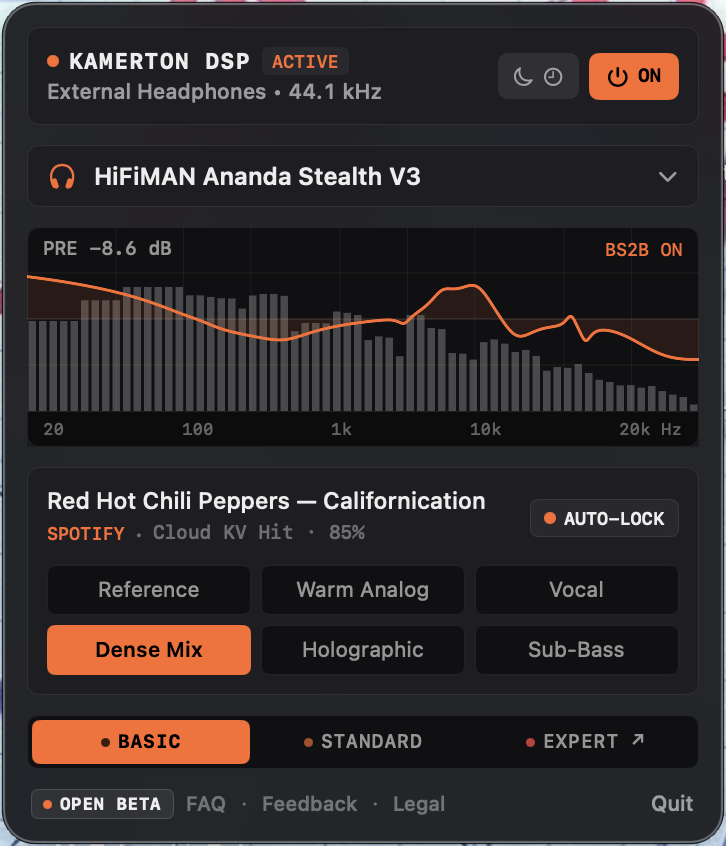
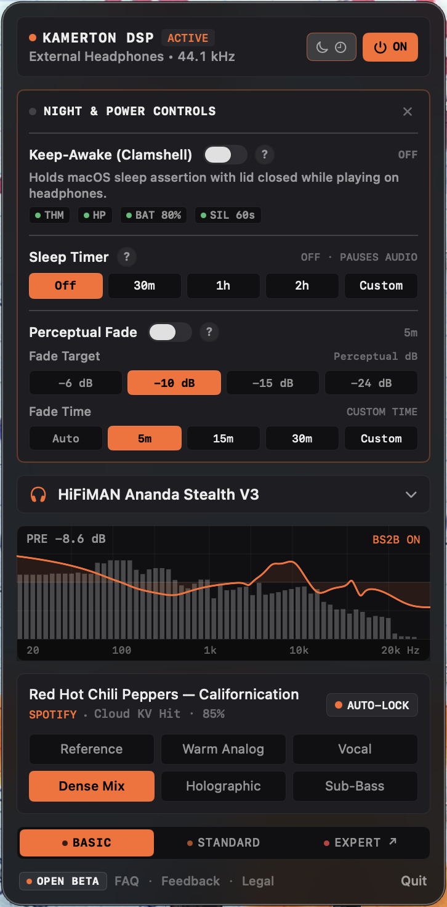
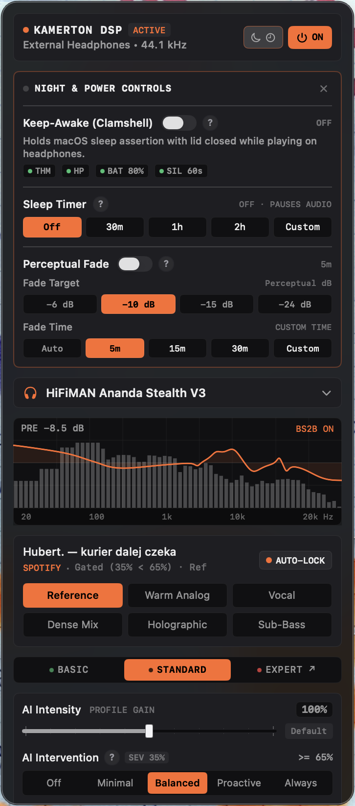
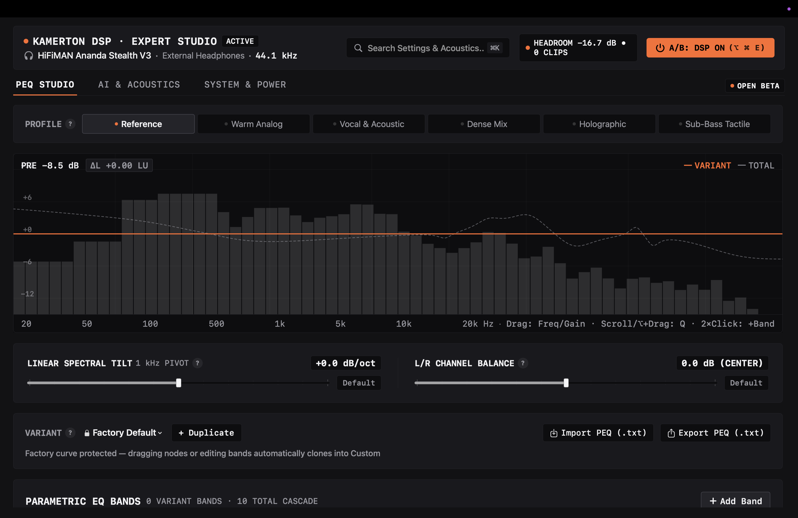

## Interface Progression (`Basic` → `Standard` → `Expert Studio`)

| Basic Mode (Zero-Config AI Lock) | Night & Power Automation | Standard Mode (AI Tuning) |
| :---: | :---: | :---: |
|  |  |  |

### Expert Studio (`PEQ Studio`, `AI & Acoustics`, `System & Power`)

---

# KamertonDSP (macOS Open Beta)

**64-Bit Reference Headphone Calibration, Crossfeed & AI Album Mastering for macOS**  
*Engineered in Wrocław, Poland · Universal Binary (`arm64` + `x86_64`, 4.1 MB) · macOS 14.4+*

KamertonDSP is a native Swift/Accelerate system-wide parametric EQ and headphone calibration processor built directly on Apple's **CoreAudio Process Tap (`CATapDescription`)** — zero virtual audio drivers, zero kernel extensions, and zero audio ever leaving your Mac.

---

## Key Features

- **Zero Virtual Drivers (`CATapDescription`):** Hooks directly into macOS 14.4+ system audio without BlackHole/Soundflower routing loops. Seamlessly follows output switching (USB DACs, headphone jack, AirPods, built-in speakers) and **automatically excludes Discord, Zoom, Microsoft Teams, FaceTime, and Slack** so calls remain uncolored.
- **64-Bit Lock-Free Real-Time Engine (`vDSP_biquadD`):** Zero allocations and zero locks inside the audio render callback.
- **8,850+ Offline AutoEq Profiles + Squiglink / REW Import:** Built-in headphone database calibrated to the Harman OE2018 target curve, plus `.txt` import/export for AutoEq, Oratory1990, Squiglink, and REW filters. Layer 1 headphone calibration stays strictly isolated from downstream tonal controls.
- **Exact 512-Point Headroom & `-0.3 dBFS` Lookahead Limiter:** Solves $|H(e^{j\omega})|$ across 512 log-spaced points (`20 Hz–20 kHz`) on every filter change and sets digital preamp to $-(\max|H| + 1.5\text{ dB})$ ahead of a `2.0 ms` lookahead peak limiter.
- **True Downward-Only ITU-R BS.1770 Loudness Matching (`⌥⌘E`):** K-weighted `1/f` pink-noise loudness integration matches perceived loudness strictly downward across profiles and A/B bypass comparisons.
- **Studio Tonal & Spatial Suite:**
  - **BS2B Crossfeed** (reduces "in-head" fatigue on hard-panned stereo recordings)
  - **Linear Spectral Tilt** (`1 kHz` pivot, `-3.0` to `+3.0 dB/oct`)
  - **Lossless L/R Channel Balance** (`0.1 dB` steps, attenuates opposite channel only)
  - **ISO 226 Night Contour** (physiological equal-loudness compensation for low-volume listening)
- **Conservative Metadata-Only AI Album Mastering (Optional):** Scores mastering deviation from local track metadata only (never audio). Audiophile reference masters (*Aja*, *The Dark Side of the Moon*, *Random Access Memories*) stay untouched on `Reference` (`0%`), while harsh or brickwalled Loudness War masters engage subtle tilt/trim when crossing your selected threshold (`Minimal`, `Balanced`, `Proactive`, `Always`, or `Off`).
- **Clamshell Keep-Awake & Perceptual Fade:** Closed-lid headphone listening protected by 4 hardware safety guards (macOS thermal state, headphone unplug auto-bypass, battery floor guard, and `-80 dBFS` silence auto-release), paired with a constant-rate (`1.0 dB/min`) Perceptual Fade and Sleep Timer.

---

## Installation (macOS 14.4+)

1. Download **`KamertonDSP-Beta.dmg`** from the [Releases](../../releases/latest) page.
2. Open the disk image and double-click **`Install KamertonDSP.command`**.  
   *(Copies `KamertonDSP.app` to `/Applications`, clears macOS download quarantine attributes via `xattr -cr`, and launches it in your menu bar.)*
3. On first launch, accept the Terms & Privacy notice and grant **System Audio Recording Only** permission when prompted (`System Settings → Privacy & Security → System Audio Recording Only`).

> **Note on macOS Gatekeeper:** Open Beta builds are ad-hoc signed prior to v1.0 Apple notarization. If you drag `KamertonDSP.app` manually instead of using `Install KamertonDSP.command`, open `System Settings → Privacy & Security` and click **Open Anyway**.

---

## Open Beta & Licensing

KamertonDSP is currently in **Open Beta** with all DSP, AutoEq, and AI Mastering features unlocked for testing. Core local EQ playback will remain free after the beta concludes, while advanced studio and cloud features will require a one-time v1.0 license. Active beta testers will receive extended trial access and early-supporter pricing at launch.

---

## Privacy & Safety

- **100% Local Audio Processing:** KamertonDSP never records microphone input, never writes audio buffers to disk, and never streams or uploads audio. Full GDPR details are documented in [`PRIVACY.md`](PRIVACY.md).
- **Thermal Warning (`Clamshell Keep-Awake`):** Never transport a closed MacBook inside a bag, sleeve, or enclosed space while Clamshell Keep-Awake is active due to overheating risk.

---

## Attributions & Licenses

- **AutoEq Headphone Database:** Copyright © 2018–2025 Jaakko Pasanen & AutoEq Contributors — MIT License.
- **BS2B Crossfeed:** Copyright © 2005 Boris Mikhaylov — MIT License.
- Headphone EQ curves are calibrated to the Harman OE2018 target curve (descriptive reference only; no endorsement or affiliation implied).
- All product names, headphone brands, and service names (including HiFiMAN and Spotify) are trademarks or registered trademarks of their respective owners. Their use in KamertonDSP is strictly for identification and compatibility purposes and does not imply endorsement or affiliation.
